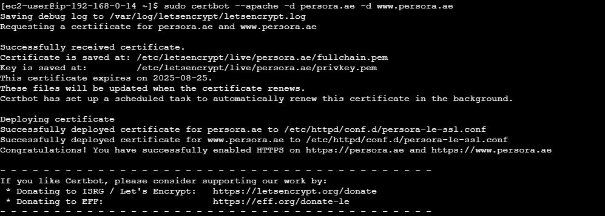
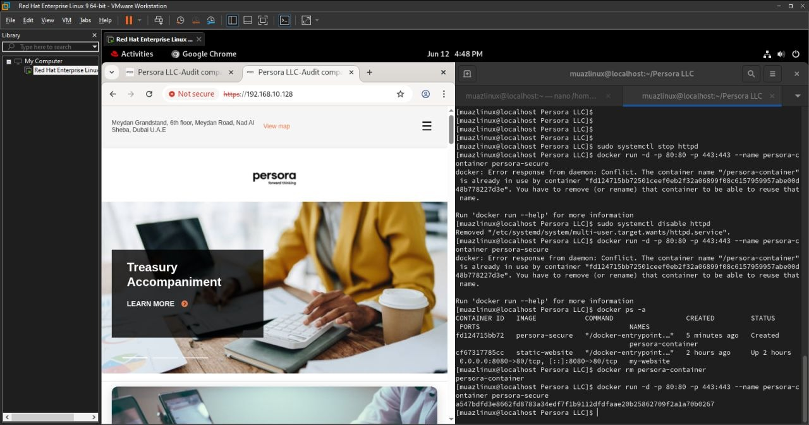

# Persora LLC Website – AWS EC2 Production Deployment & Secure Docker/Nginx on RHEL 9

A real client project for **Persora LLC**, an audit, accounting and consulting firm in Dubai, UAE: **https://persora.ae/**

I deployed the same website in **two parts**:

| | [Part 1 – Production on AWS EC2](part1-aws-ec2-production/) | [Part 2 – Docker + Nginx on RHEL 9](part2-docker-nginx-rhel9/) |
|---|---|---|
| Goal | Move the live site from ISPmanager hosting to AWS for control and scalability | Containerise the site and serve it over HTTPS on a hardened Linux server |
| Platform | EC2 `t2.micro`, Amazon Linux 2023 | Red Hat Enterprise Linux 9 VM (VMware) |
| Web server | Apache 2.4 | Nginx (`nginx:alpine`) in Docker |
| SSL | Let's Encrypt (Certbot), automatic renewal | Self-signed certificate (OpenSSL) |
| Security | Security Groups, OS firewall, HTTP→HTTPS redirect | firewalld custom zone `webzone`, HTTP→HTTPS redirect |
| Troubleshooting | IPv6 conflict blocking SSL validation; public IP changing after restart | Port 80 conflict with Apache; container name conflict |

Each part has its own README with the problem, architecture, step-by-step explanation, screenshots and files.

## Part 1 at a glance
Moved the site to EC2 over SFTP → pointed DNS A records to EC2 → issued a Let's Encrypt certificate for `persora.ae` and `www.persora.ae` → forced HTTPS → tested an instance restart.
**→ [Read Part 1](part1-aws-ec2-production/README.md)**



## Part 2 at a glance
Installed Docker CE → built an `nginx:alpine` image of the site → added HTTPS with OpenSSL → fixed port and name conflicts → hardened with firewalld.
**→ [Read Part 2](part2-docker-nginx-rhel9/README.md)**



## What I learned
- Moving a live site from shared hosting to the cloud: DNS records, propagation and IPv6 pitfalls
- How Let's Encrypt validates a domain, automatic renewal, and rate limits
- Apache virtual hosts and HTTPS redirects
- Docker images, containers, port mapping, and fixing conflicts
- TLS in Nginx, and how self-signed and CA-signed certificates differ
- Layered security: cloud Security Groups and host firewalls (firewalld zones)

## Repository structure
```
part1-aws-ec2-production/   README, commands.md, apache/ (vhost + SSL config)
part2-docker-nginx-rhel9/   README, commands.md, Dockerfile, Dockerfile.https, nginx/default.conf
website/                    put the site files here (client code is not published)
docs/screenshots/           screenshots; IPs, hostnames, credentials and instance IDs are blurred
```

> **Note:** the website source code belongs to the client and is not included. Certificates and private keys are never committed (see `.gitignore`). Files marked "rebuilt" were recreated from the project steps because the originals were not kept.

## Author
**Muaz Naveed** – [GitHub](https://github.com/muaz-405) · [LinkedIn](https://linkedin.com/in/muaz-naveed-8754211ab)
