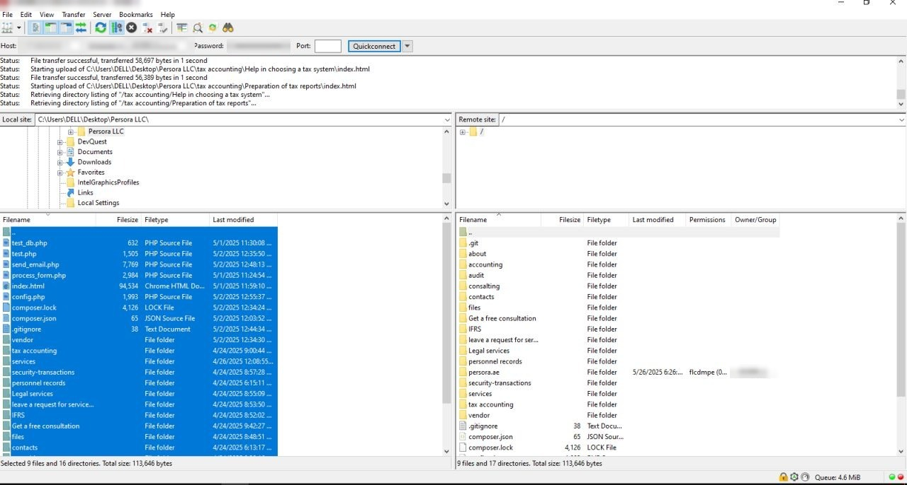
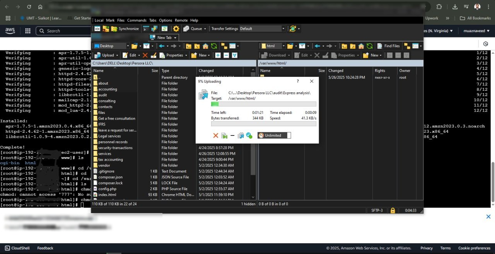
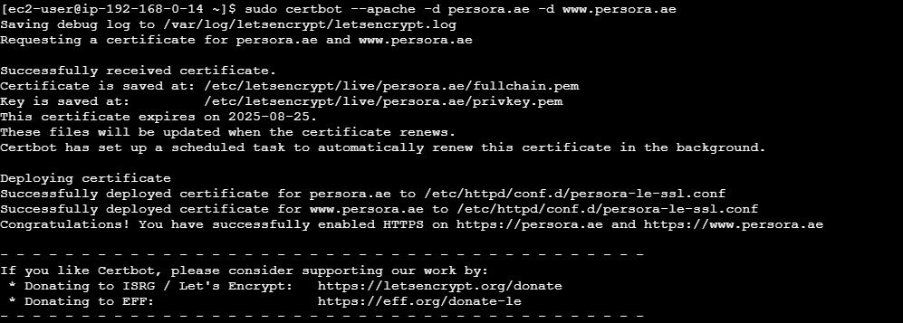
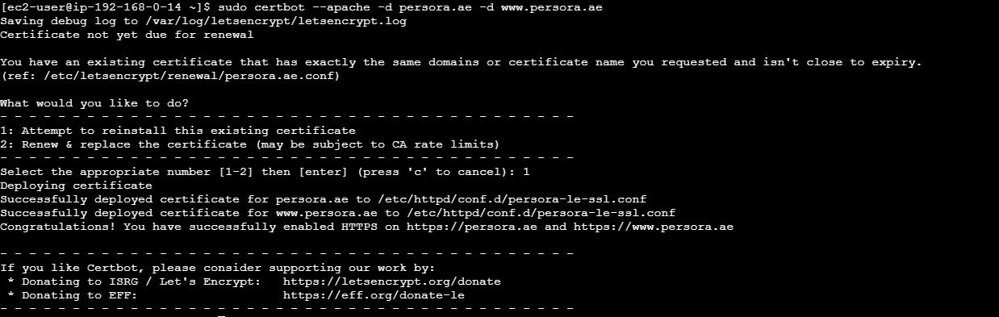
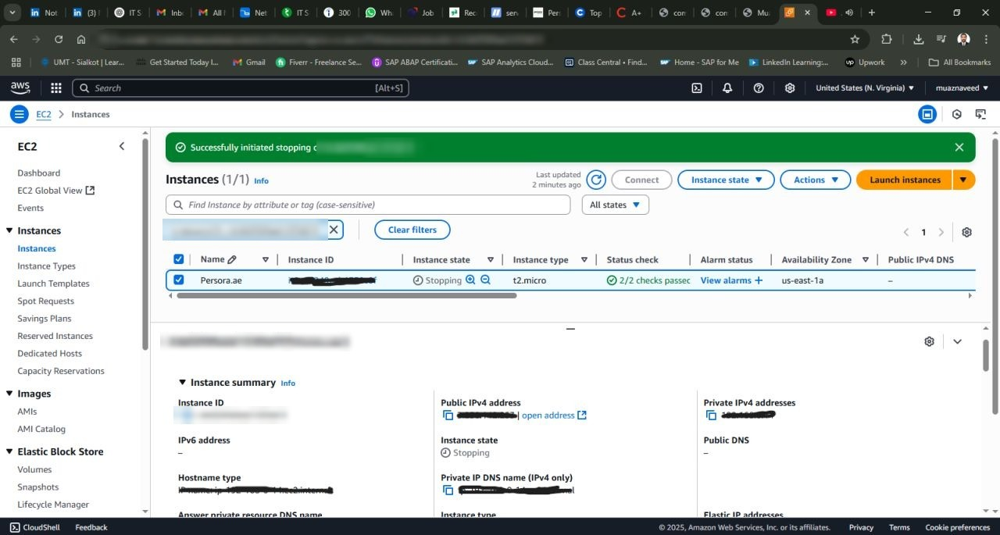

# Part 1 – Moving the Persora production website to AWS EC2

**Live site:** https://persora.ae/ · **Stack:** AWS EC2 (Amazon Linux 2023), Apache 2.4, Let's Encrypt / Certbot, ISPmanager DNS, FileZilla, WinSCP, Bash

## The problem
The client's website ran on an **ISPmanager VPS**, which gave little control over the server, SSL or scaling. The goal was to move the live site to **AWS EC2** with:
- valid HTTPS that renews itself
- all traffic forced to HTTPS
- traffic locked down at both the cloud and the OS level
- as little downtime as possible

## Architecture

```
  Visitor ──► DNS (ISPmanager)  persora.ae / www.persora.ae  ──A record──►  EC2 public IP
                                                                              │
                                     ┌────────────────────────────────────────▼───────┐
                                     │ AWS us-east-1 · EC2 t2.micro · Amazon Linux 2023 │
                                     │ Security Group: 22 (my IP), 80, 443               │
                                     │                                                  │
                                     │ Apache :80  ──301 redirect──►  Apache :443 (TLS) │
                                     │                               Let's Encrypt cert │
                                     │ /var/www/html  (site files)                       │
                                     └──────────────────────────────────────────────────┘
```

## Step by step

### 1. Starting point – the old ISPmanager hosting
The site was managed over SFTP with FileZilla on the ISPmanager server. I kept a complete local copy of the site to move to AWS.



### 2. Launching EC2 and installing Apache
I launched a `t2.micro` instance with **Amazon Linux 2023** in us-east-1 and installed Apache (`httpd`). The **Security Group** allows only SSH (22, restricted), HTTP (80) and HTTPS (443).

### 3. Uploading the site
I copied the site files to `/var/www/html/` over SFTP with **WinSCP**, then set the correct owner and permissions so Apache can read them.



### 4. DNS cut-over
In ISPmanager's DNS settings I pointed the **A records** of `persora.ae` and `www.persora.ae` to the EC2 public IP, then checked with `dig` that propagation was complete.

Let's Encrypt validation first failed because of an **IPv6 conflict**: Let's Encrypt prefers IPv6, so if the domain resolves over IPv6 to a server other than the EC2 instance, validation fails. After I resolved this, validation succeeded.

### 5. HTTPS with Let's Encrypt
Certbot's Apache plugin did three things:
- proved I control the domain (HTTP-01 challenge)
- obtained one certificate for both `persora.ae` and `www.persora.ae`
- wrote the SSL virtual host `persora-le-ssl.conf` and set up **automatic renewal** (the certificate is valid for 90 days)



Later I re-ran Certbot. It found the existing certificate, and I chose **"1: reinstall"** instead of requesting a new one. This avoids Let's Encrypt **rate limits**.



### 6. Forcing HTTPS
The port-80 virtual host returns a **301 permanent redirect** to `https://`, so visitors and search engines always use the secure site. See [`apache/persora.conf`](apache/persora.conf).

### 7. Restart / failover test
I stopped and started the instance to confirm that Apache and HTTPS come back automatically (`systemctl enable httpd`).

I also documented one important point: without an **Elastic IP**, the EC2 public IPv4 address **changes after a stop/start**. The DNS A records then have to be updated, or an Elastic IP attached.



## Files
| File | What it is |
|---|---|
| [`commands.md`](commands.md) | All commands in order |
| [`apache/persora.conf`](apache/persora.conf) | HTTP virtual host with HTTPS redirect (rebuilt) |
| [`apache/persora-le-ssl.conf`](apache/persora-le-ssl.conf) | HTTPS virtual host generated by Certbot (standard form) |

## Result
https://persora.ae and https://www.persora.ae are served from AWS EC2 with a trusted Let's Encrypt certificate that renews automatically. All HTTP traffic is redirected to HTTPS.
