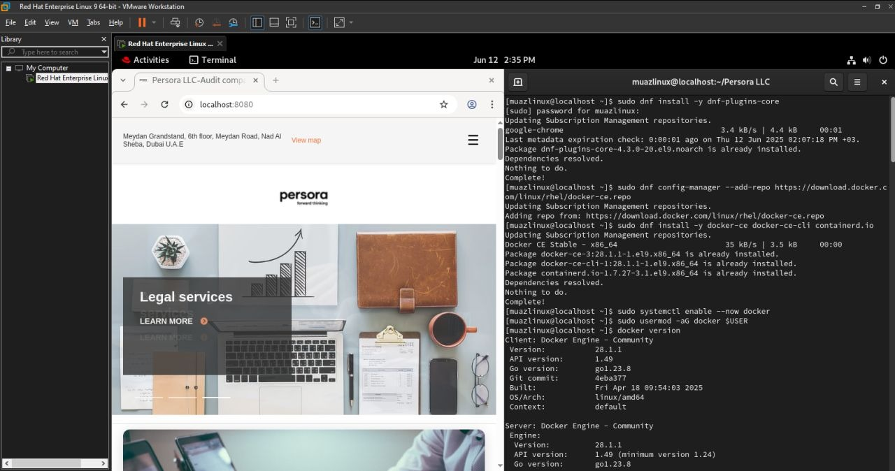
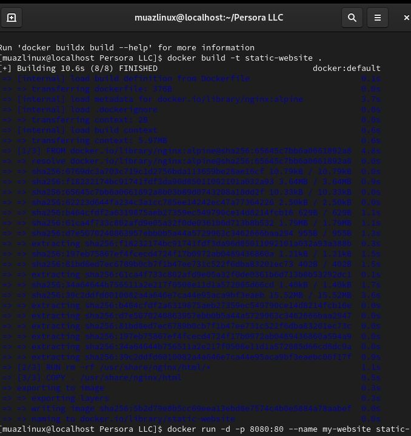
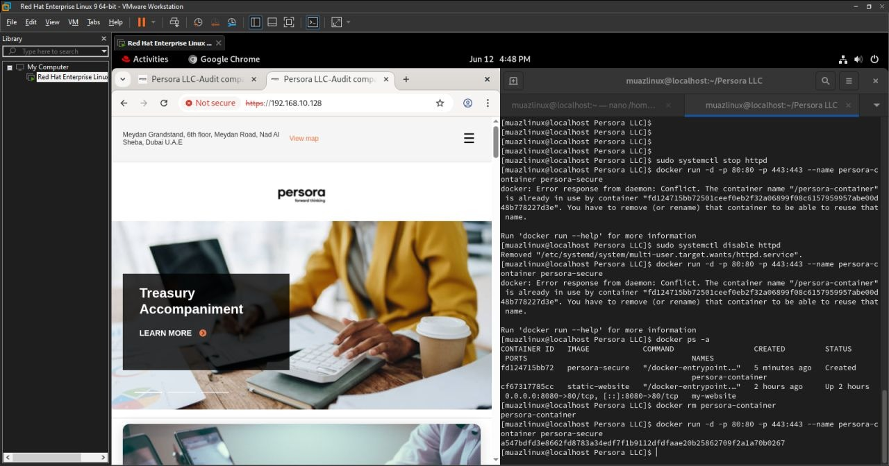
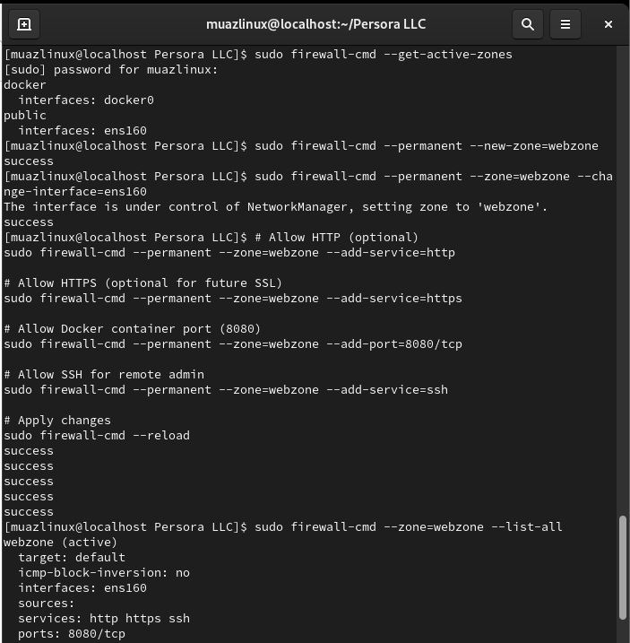
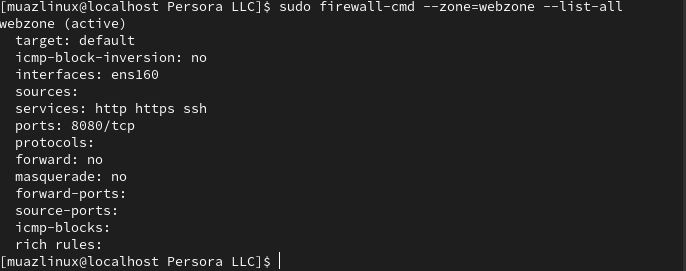

# Part 2 – Secure Docker + Nginx deployment on RHEL 9

**Stack:** Red Hat Enterprise Linux 9 (VMware), Docker CE 28.1.1, Nginx (`nginx:alpine`), OpenSSL, firewalld

## The goal
After delivering the website, I packaged the same site as a **container**. That makes it portable and easy to redeploy on any server. I then served it over **HTTPS** on a Linux server hardened with firewalld.

## Architecture

```
  Browser ──https://192.168.10.128──►  RHEL 9 VM (ens160, firewalld zone "webzone")
                                          │  allowed: http, https, ssh, 8080/tcp
                                          ▼
                              ┌────────── Docker ──────────────────────────┐
                              │ persora-container  (image persora-secure)   │
                              │   host 80  ─► nginx :80  ─301─► https       │
                              │   host 443 ─► nginx :443  TLS               │
                              │              /etc/nginx/ssl (self-signed)    │
                              │              /usr/share/nginx/html (site)    │
                              │                                             │
                              │ my-website  (image static-website)          │
                              │   host 8080 ─► nginx :80   (HTTP test)       │
                              └─────────────────────────────────────────────┘
```

## Step by step

### 1. Installing Docker CE on RHEL 9
I added Docker's official repository, installed `docker-ce`, `docker-ce-cli` and `containerd.io`, and enabled the service. I also added my user to the `docker` group so I don't need sudo for every command.

### 2. First container – HTTP on port 8080
The [`Dockerfile`](Dockerfile) takes three steps on the small `nginx:alpine` image:
1. start from `nginx:alpine`
2. delete the default Nginx page
3. copy the website into `/usr/share/nginx/html`

I ran it as `my-website` with host port **8080** mapped to container port 80.





### 3. HTTPS with a self-signed certificate
I generated a certificate and private key with **OpenSSL** and built a second image, `persora-secure`. It copies the certificate into `/etc/nginx/ssl` and uses an Nginx config with:
- `listen 443 ssl` with the certificate (TLS 1.2 and 1.3)
- a **301 redirect** from port 80 to HTTPS

See [`Dockerfile.https`](Dockerfile.https) and [`nginx/default.conf`](nginx/default.conf).

A self-signed certificate encrypts traffic but isn't trusted by browsers, so Chrome shows **"Not secure"**. In production (Part 1) a CA-signed Let's Encrypt certificate is used instead.

### 4. Troubleshooting – port and name conflicts
Two errors came up when I started the HTTPS container:

| Problem | Cause | Fix |
|---|---|---|
| Port 80 already in use | Apache (`httpd`) was running on the host | `systemctl stop httpd` and `systemctl disable httpd` |
| `Conflict. The container name "/persora-container" is already in use` | A failed earlier attempt left a container in the `Created` state | `docker ps -a` to find it, `docker rm persora-container`, then run again |

After both fixes the site loaded at **https://192.168.10.128**.



### 5. Hardening with firewalld
By default the interface `ens160` was in the `public` zone. I created a custom zone, **`webzone`**, moved `ens160` into it, and allowed only what the server needs:

| Allowed | Why |
|---|---|
| `http` (80) | redirect to HTTPS |
| `https` (443) | the website |
| `ssh` (22) | remote administration |
| `8080/tcp` | the HTTP test container |

Everything else is blocked. Masquerading and forwarding are off.





## Files
| File | What it is |
|---|---|
| [`commands.md`](commands.md) | All commands in order |
| [`Dockerfile`](Dockerfile) | HTTP image `static-website` (matches the build log) |
| [`Dockerfile.https`](Dockerfile.https) | HTTPS image `persora-secure` (rebuilt) |
| [`nginx/default.conf`](nginx/default.conf) | Nginx HTTPS + redirect config (rebuilt) |

## Result
The Persora website runs in a Docker container behind Nginx with HTTPS, on a RHEL 9 server where firewalld allows only the needed services.
